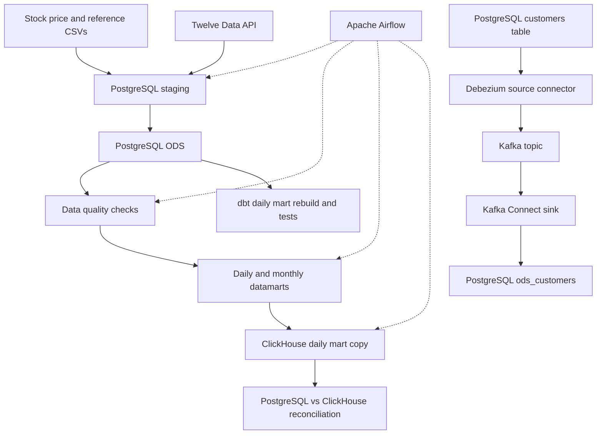

# Stock Market Data Engineering Pipeline

**Data Engineering Final Project**  
**Author:** Aisha Shermatova  
**Focus:** Data ingestion, orchestration, warehousing, data quality, analytical consistency, and change data capture (CDC)

## Overview

This project implements a stock-market data warehouse for daily U.S. equity data. Apache Airflow orchestrates ingestion from CSV files and the Twelve Data API into a three-layer PostgreSQL architecture: **staging (STG), operational data store (ODS), and datamarts**.

The system builds daily and monthly analytical summaries, copies the daily mart into ClickHouse, and compares PostgreSQL and ClickHouse aggregates. A separate dbt implementation rebuilds the daily mart and applies automated tests. The repository also contains a distinct Debezium–Kafka Connect CDC demonstration that replicates changes from a PostgreSQL `customers` table into `ods_customers`.

The objective is **trustworthy, repeatable data processing**, not stock-price prediction or trading strategy development.

## Architecture



Solid arrows represent data movement or processing dependencies; dotted arrows represent Airflow orchestration. The **CDC branch is a separate demonstration**, not part of the stock-price ETL path.

## Technology stack

| Component | Role |
|---|---|
| Python and SQL | Ingestion, transformations, validation, and reporting |
| Apache Airflow 2.10 | Task orchestration, dependencies, retries, and monitoring |
| PostgreSQL 16 | Staging, ODS, and analytical datamarts |
| ClickHouse | Copy of the daily mart and cross-database reconciliation |
| dbt-postgres 1.8 | Independent daily mart implementation and automated tests |
| Apache Kafka, Kafka Connect, Debezium | Change data capture from a separate PostgreSQL table |
| Twelve Data API | Daily price observations for a limited set of symbols |

Versions refer to the original course environment; they are **not a tested standalone deployment specification**.

## Repository structure

```text
dag/    Airflow DAGs and shared helper etl_common.py
sql/    PostgreSQL DDL, ODS loads, and datamart SQL
dbt/    dbt models, schema tests, singular tests, and environment-based profile
cdc/    Kafka Connect connector templates, registration and verification scripts, CDC SQL
data/   Input-data instructions, transformation script, and small CSV samples
docs/   Dataset passport, data model, and presentation PDF
```

### Main workflows

- **`final_shermatova_pipeline`** — loads staging data, builds ODS tables, runs ODS quality checks, then triggers the datamart DAG using the same processing date.
- **`final_shermatova_datamart`** — builds the daily and monthly marts, checks them, copies the daily mart into ClickHouse, and compares row counts and volume totals across databases.
- **`final_shermatova_report`** — read-only reporting DAG for layer counts, load-log records, and PostgreSQL/ClickHouse totals.
- **dbt** — independently computes `dm_prices_daily_dbt` from ODS models and checks its consistency with the Airflow-built mart.
- **CDC demonstration** — uses Debezium and Kafka Connect to replicate `shermatova.customers` into `shermatova_ods.ods_customers`. This is separate from the stock-price data pipeline.

See [Data model](docs/data_model.md) for schemas, grains, keys, and metric definitions, and [Dataset passport](docs/dataset_passport.md) for source provenance and dataset details.

## Recorded validation results

The following figures are **reported results from the original course environment for trading day 2026-11-06**, as documented in the project. They have **not been independently re-executed from this GitHub repository**.

| Check | Recorded result |
|---|---|
| Price-file rows vs. daily staging rows | 503 = 503 |
| Daily mart | 503 tickers; total volume 3,447,232,295 shares; 317 advances, 183 declines, 3 unchanged |
| Exchange breakdown | NYSE: 342; NASDAQ: 160 (two market codes); Cboe: 1; recorded total matches the daily mart |
| API cross-check | 8 tickers; recorded average close-price difference: 0.00% |
| PostgreSQL vs. ClickHouse | Matching row count and sum of volume |
| Same-date rerun | Row counts unchanged across layers |
| dbt build | 1 model and 8 tests passed (`PASS=9`); results reported to match the Airflow-built mart |
| CDC: `customers` → `ods_customers` | Project documentation reports 20,000 rows, matching checksums, and insert/update/delete propagation within 30 seconds |

**Evidence boundary:** These figures come from the project's recorded course-run summary. The code contains checks and reconciliation routines, but this README does not provide the original execution logs or independently establish the latency and row-count claims. See the CDC scripts in [`cdc/`](cdc/) for the implementation that this repository actually contains.

## Engineering controls and requirement coverage

| Engineering concern | Implementation |
|---|---|
| File and API ingestion | `dag/final_shermatova_pipeline.py`; source information in `data/README.md` |
| Raw staging fields and load metadata | `sql/01_ddl.sql`, `dag/final_shermatova_pipeline.py` |
| Typed, keyed ODS tables | `sql/01_ddl.sql`, `sql/02_ods_*.sql` |
| Load audit log | `shermatova_stg.etl_load_log`; `logged()` in `dag/etl_common.py` |
| Daily and monthly datamarts | `sql/03_dm_*.sql`, `docs/data_model.md` |
| Consistent processing date between DAGs | `trigger_datamart` / `wait_datamart` in the main pipeline DAG |
| ODS and mart quality checks | `CHECKS_ODS`, `CHECKS_DM` in `dag/etl_common.py` |
| Same-day replacement for event data | `replace_day()` in `dag/etl_common.py`; day-scoped transformations |
| ClickHouse copy and reconciliation | `dag/final_shermatova_datamart.py` |
| Independent dbt model and tests | `dbt/models/`, `dbt/tests/` |
| Kafka-based CDC demonstration | `cdc/` connector templates, SQL, and verification script |
| API failure handling | `load_stg_api` uses a 20-second request timeout and Airflow task retry configuration; it validates the response before replacing that day's staging rows |
| Credential configuration | Airflow Connections and environment variables; inspect configuration before use |

**Important distinction:** A same-date rerun replaces the relevant dated records; it is not a claim that every table uses the identical replacement mechanism. Reference datasets are also handled through their own loading logic.

## Running in the original course environment

The project was built for a shared course environment with **PostgreSQL 16, Apache Airflow 2.10, dbt-postgres 1.8, ClickHouse, Kafka Connect, and Debezium**.

**Reproducibility note:** The DAGs import `student_dag` from the course-specific helper `_lib.tenant`. This helper is not included in the repository. Executing the pipeline outside the course environment requires adapting the DAG definitions (for example, to standard Airflow `DAG` objects), provisioning the dependent services, and configuring compatible connections, paths, database permissions, and data files. The steps below document the *original environment*, not a tested one-command local installation.

### 1. Place the files and obtain the datasets

In the original environment, place the project under `~/work/dags/project/`. The three main input CSV files are described in [data/README.md](data/README.md):

- `prices_daily.csv` — long-format daily price history, prepared using `data/prepare_prices.py` from the source dataset;
- `12data_stocks.csv` — Twelve Data equity reference data;
- `12data_stock_exchanges.csv` — Twelve Data exchange reference data.

The repository includes **small sample CSVs**, not the complete source files. Obtain the inputs from their original providers and review their usage terms.

### 2. Configure Airflow Connections

Set the following connections in the course environment (Airflow → Admin → Connections):

- `aiacademy_pg_shermatova`: PostgreSQL connection for the `aiacademy` database;
- `shermatova_clickhouse`: ClickHouse connection;
- `twelvedata_shermatova`: HTTP connection with host `https://api.twelvedata.com` and the API key stored in the connection's secret/password field.

Do not commit credentials into code, documentation, or connector templates.

### 3. Run the main DAGs

Enable `final_shermatova_pipeline` and `final_shermatova_datamart`. Trigger the pipeline for the recorded test date **2026-11-06**, or supply the configuration below when triggering manually:

```json
{"ds": "2026-11-06"}
```

The pipeline passes the date to the datamart DAG. Use a trading date for which the required source records exist.

### 4. Inspect PostgreSQL outputs

With PostgreSQL client connection variables configured in the terminal:

```bash
psql -c "SELECT * FROM shermatova_stg.etl_load_log ORDER BY id DESC LIMIT 15;"
psql -c "SELECT count(*) FROM shermatova_stg.stg_prices_daily WHERE _ds = '2026-11-06';"
psql -c "SELECT * FROM shermatova_datamart.dm_prices_daily;"
psql -c "SELECT * FROM shermatova_datamart.dm_prices_exchange_month;"
```

Run `final_shermatova_report` for additional read-only reporting, including PostgreSQL and ClickHouse totals.

### 5. Build and test the dbt mart

From the project root, with the required `PGHOST`, `PGPORT`, `PGUSER`, `PGPASSWORD`, and `PGDATABASE` environment variables set:

```bash
cd dbt
dbt build -s dm_prices_daily_dbt --profiles-dir profiles
```

The recorded course run reported `PASS=9` (one model and eight tests). This command requires the corresponding populated PostgreSQL source tables.

### 6. Run the separate CDC demonstration

The published CDC implementation replicates **`shermatova.customers` → `shermatova_ods.ods_customers`**, not the stock-price table. It requires an accessible source table, configured replication permissions, Kafka Connect/Debezium, and the necessary PostgreSQL environment variables.

From the repository root in the original environment:

```bash
psql -v ON_ERROR_STOP=1 -f cdc/sql/00_sink_table.sql
psql -v ON_ERROR_STOP=1 -f cdc/sql/01_publication.sql
python cdc/register.py
sh cdc/status.sh
python cdc/verify_cdc.py
```

The demo scripts can then exercise changes and restoration:

```bash
psql -v ON_ERROR_STOP=1 -f cdc/sql/02_change_demo.sql
# Allow the connector pipeline to process changes, then:
python cdc/verify_cdc.py

psql -v ON_ERROR_STOP=1 -f cdc/sql/03_revert.sql
# Allow the connector pipeline to process changes, then:
python cdc/verify_cdc.py
```

**Use the following cleanup only in an isolated or explicitly authorized course environment.** It removes connector resources and related CDC setup:

```bash
python cdc/register.py --delete
psql -v ON_ERROR_STOP=1 -f cdc/sql/99_cleanup.sql
```

Do not run setup, mutation, or cleanup commands against production or shared infrastructure without permission.

## Reliability and failure scenarios

The following are **test procedures supported by the implementation**, not a claim that every scenario has a separately archived execution log:

- **Rerun behavior:** Run the same processing date again and compare counts and aggregates. Dated staging and mart loads are designed to avoid accumulating duplicate records on rerun.
- **API unavailability:** In a nonproduction test environment, deliberately configure an unreachable API endpoint. Confirm that `load_stg_api` fails after its configured retries without committing an invalid or partial API payload, then restore the connection.
- **Invalid source values:** In a disposable test database, introduce a deliberately invalid price value and rerun the relevant ODS quality check. The check should report a violation; reloading the date should restore valid source-derived data.
- **CDC consistency:** Compare source and sink counts and checksums with `cdc/verify_cdc.py` after changes have been processed. Successful execution depends on the original environment and data.

## Credential handling

The project is **designed** to obtain credentials from Airflow Connections or environment variables rather than embedding them directly in source files:

- Airflow connections provide PostgreSQL, ClickHouse, and Twelve Data credentials.
- The dbt profile at `dbt/profiles/profiles.yml` reads PostgreSQL credentials from environment variables.
- `cdc/register.py` reads PostgreSQL connection variables when rendering connector configuration.
- The Twelve Data API key is provided through the request's authorization header rather than a URL query parameter.

**Security caveat:** These design choices do not constitute a comprehensive secrets audit. Review the full repository and Git history before publishing, and use dedicated low-privilege credentials. Kafka Connect configuration APIs may expose resolved connector configuration to authorized administrators, so restrict access to the connector service and use an appropriate secret-management mechanism for deployment.

## Known limitations

- **Course-specific dependency:** `_lib.tenant.student_dag` is not included; standalone deployment requires adaptation and infrastructure setup.
- **External data required:** The complete input datasets are not included in GitHub; only small examples are provided.
- **API quota:** The original free-plan workflow requests eight predefined symbols (`API_SYMBOLS` in `dag/etl_common.py`) per run; quotas and API responses depend on the provider's plan and current policies.
- **Processing granularity:** A pipeline run targets a single processing date. Nontrading dates may yield no price rows; zero-row completion should not automatically be interpreted as successful data coverage.
- **ClickHouse scope:** Only the daily mart is copied to ClickHouse; the separate CDC demonstration targets PostgreSQL.
- **Validation evidence:** Recorded results originate from the original course run; independent deployment and execution have not been demonstrated by this repository.

## Project scope

This is an educational engineering project demonstrating ingestion, orchestration, warehousing, quality checks, reconciliation, and CDC. It is not a production trading system or an investment recommendation.
