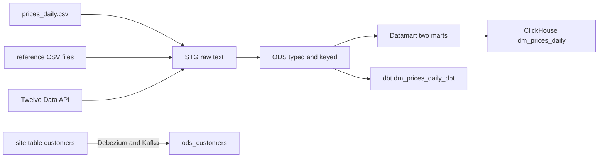

# Stock-market data warehouse

Final project, Data Engineering. Author: Aisha Shermatova (login `shermatova`).

Daily US stock prices (CSV files plus the Twelve Data API) are loaded by Airflow into PostgreSQL through three layers
(stg, ods, datamart). One mart is copied to ClickHouse and the same mart is rebuilt with dbt. Changes of a site table reach
the ods layer through Debezium and Kafka (CDC). The focus is trustworthy, repeatable data processing, not price prediction.



## Repository

```
dag/    Airflow DAGs and the shared helper etl_common.py
sql/    all SQL of the layers: DDL, ods loads, marts
dbt/    dbt project: one mart, 8 tests, profile without secrets
cdc/    Debezium and Kafka Connect: connector templates, register script, checks
data/   notes on the three input files and the script that builds prices_daily.csv
docs/   dataset passport, data model, presentation (PDF)
```

* DAG `final_shermatova_pipeline`: loads stg, builds ods, runs quality checks, triggers the datamart DAG with the same logical date.
* DAG `final_shermatova_datamart`: builds both marts, runs checks, copies `dm_prices_daily` to ClickHouse, reconciles Postgres and ClickHouse.
* DAG `final_shermatova_report`: read-only helper that prints row counts per layer, the last load-log rows and Postgres vs ClickHouse totals.
* Details of layers, tables, grain, keys and metric definitions: [docs/data_model.md](docs/data_model.md). Sources: [docs/dataset_passport.md](docs/dataset_passport.md).

## Verified results (course stand, trading day 2026-11-06)

| Check | Result |
|---|---|
| Staging rows for the day vs rows of the price file | 503 = 503 |
| Daily mart | 503 tickers, 3,447,232,295 shares, 317 up, 183 down, 3 unchanged |
| Exchange mart (month x exchange) | NYSE 342, NASDAQ 160 (two market codes), Cboe 1; its total equals the daily mart |
| API cross-check | 8 tickers, 0.00% average difference between file close and API close |
| Postgres vs ClickHouse | same row count and same sum of volume |
| Re-run of the same date | all row counts unchanged in every layer |
| dbt | 1 model and 8 tests passed, result equals the Airflow-built mart |
| CDC (`customers` to `ods_customers`) | 20,000 rows, checksums equal; insert, update and delete arrive within 30 seconds |

## How the requirements are covered

| Requirement | Where |
|---|---|
| Sources: 2 CSV files and 1 API | `docs/dataset_passport.md`, `data/README.md` |
| stg as text plus `_ds`, `_source_file`, `_loaded_at` | `sql/01_ddl.sql`, `dag/final_shermatova_pipeline.py` |
| ods with types, keys, no duplicates | `sql/01_ddl.sql`, `sql/02_ods_*.sql` |
| Load journal (one row per task attempt) | table `shermatova_stg.etl_load_log`, function `logged` in `dag/etl_common.py` |
| Two marts (day; month x exchange), one uses the API | `sql/03_dm_*.sql`, `docs/data_model.md` |
| Main DAG starts the datamart DAG with the same date | tasks `trigger_datamart` and `wait_datamart` |
| Copy to ClickHouse without duplicates, reconciliation | `dag/final_shermatova_datamart.py` |
| dbt model with `ref()` and tests | `dbt/` |
| CDC of one table through Debezium and Kafka | `cdc/` |
| Quality checks (keys, values, totals) | `CHECKS_ODS`, `CHECKS_DM` in `dag/etl_common.py`; dbt tests |
| Re-run safe | every load deletes its own date and inserts it again in one transaction |
| API timeout and retries, no partial data | task `load_stg_api`: timeout 20 s, 3 retries, writes only after the answer is validated |
| No secrets in files | Airflow Connections and environment variables only (see below) |

## Run it from scratch

The project was built on the course stand (Postgres 16, Airflow 2.10, dbt-postgres 1.8, ClickHouse, Kafka Connect with Debezium).
The DAG files import `student_dag` from the stand helper `_lib.tenant`; outside the stand replace it with the standard `airflow.DAG`.

1. **Files.** Copy the repository to `~/work/dags/project/`. Put the three input files into `data/` (see `data/README.md`).
2. **Airflow connections** (Admin, Connections):
   * `aiacademy_pg_shermatova`: Postgres connection, database `aiacademy`;
   * `shermatova_clickhouse`: ClickHouse connection;
   * `twelvedata_shermatova`: type HTTP, host `https://api.twelvedata.com`, the API key goes into the secret field of the form.
3. **Switch on** the DAGs `final_shermatova_pipeline` and `final_shermatova_datamart`.
4. **Run a day.** Trigger `final_shermatova_pipeline` with the logical date `2026-11-06` (a working day: the price file has no rows for weekends), or use the trigger page
   `/dags/<dag id>/trigger` and the configuration `{"ds": "2026-11-06"}`.
5. **Check** (terminal, the `PG*` variables are set):
   ```
   psql -c "select * from shermatova_stg.etl_load_log order by id desc limit 15"
   psql -c "select count(*) from shermatova_stg.stg_prices_daily where _ds = '2026-11-06'"
   psql -c "select * from shermatova_datamart.dm_prices_daily"
   psql -c "select * from shermatova_datamart.dm_prices_exchange_month"
   ```
   The helper DAG `final_shermatova_report` prints an overview, including Postgres vs ClickHouse.
6. **dbt:** `cd dbt && dbt build -s dm_prices_daily_dbt --profiles-dir profiles` ends with `PASS=9`.
7. **CDC**, from the repository root:
   ```
   psql -v ON_ERROR_STOP=1 -f cdc/sql/00_sink_table.sql     # target table
   psql -v ON_ERROR_STOP=1 -f cdc/sql/01_publication.sql    # publication for Debezium
   python cdc/register.py                                   # creates both connectors
   sh cdc/status.sh                                         # both must be RUNNING
   python cdc/verify_cdc.py                                 # source = ods_customers: OK
   psql -f cdc/sql/02_change_demo.sql                       # update + insert, wait 30 s, run verify_cdc.py again
   psql -f cdc/sql/03_revert.sql                            # restore + delete, wait 30 s, run verify_cdc.py again
   ```
   Remove everything with `python cdc/register.py --delete` and `psql -f cdc/sql/99_cleanup.sql`.

## Failure checks

* **Re-run the same date:** trigger it again; the counts stay the same.
* **API down:** change the host of the connection `twelvedata_shermatova` to a wrong address and run. `load_stg_api` turns red after its retries and `stg_twelvedata` gets no rows. Restore the host afterwards.
* **Broken data:** `psql -c "update shermatova_ods.ods_prices set close_price = -1 where trade_date = '2026-11-06' and ticker = 'AAPL'"`, then clear the task `dq_ods` of that run in Airflow. It fails and names the check. Running the day again repairs it.

## Secrets

No secret is stored in code, `profiles.yml`, connector files, docs or this file. Postgres, ClickHouse and the API key live in Airflow
Connections. dbt and `cdc/register.py` read the terminal variables `PGHOST`, `PGPORT`, `PGUSER`, `PGDATABASE` and the secret
variable of the terminal. A search for the word that starts with "pass" finds only lines that read these Connections or variables.
The API key is sent in a request header, never in a URL.

## Known limits

* The free API plan allows 8 requests a minute, so each run asks for 8 tickers (`API_SYMBOLS` in `dag/etl_common.py`).
* One run loads one trading day. On weekends and holidays the run finishes green with 0 rows.
* Only the daily mart is copied to ClickHouse; CDC targets PostgreSQL.
